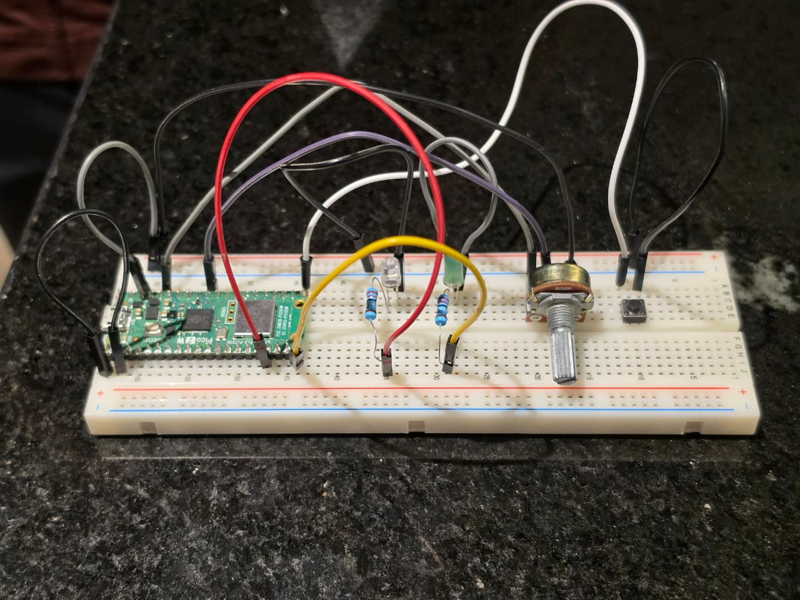
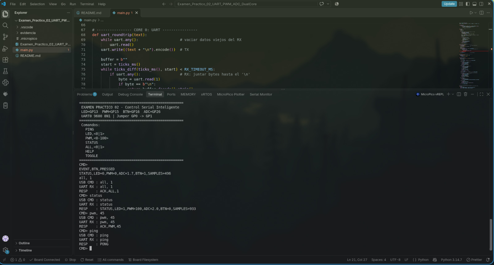

# Examen Práctico 02 - Sistema de Control Serial Inteligente

**Materia:** Laboratorio de Elementos Programables
**Temas:** UART • PWM • ADC • Entrada digital • Procesamiento Dual-Core

**Integrantes (trabajo en equipo):**

- Angel Rugerio Jiménez · 201720
- Axel García Arellano · 201251

**Placa:** Raspberry Pi Pico 2 W con MicroPython, programada desde VS Code con la extensión MicroPico.

| Archivo                                                                                                  | Qué hace                                                                             |
| -------------------------------------------------------------------------------------------------------- | ------------------------------------------------------------------------------------ |
| [`main.py`](./main.py)                                                                                   | Programa de la demostración: parser serial (Core 0) + adquisición ADC/botón (Core 1) |
| [`evidencia/`](./evidence)                                                                               | Foto del montaje y capturas de la terminal                                           |
| [`Examen_Practico_02_UART_PWM_ADC_DualCore_v2.docx`](./Examen_Practico_02_UART_PWM_ADC_DualCore_v2.docx) | Enunciado del examen                                                                 |

## 1. Pines y montaje

| Elemento                                            | Pin de la Pico  | Pata física | Función                                   |
| --------------------------------------------------- | --------------- | ----------- | ----------------------------------------- |
| LED digital + resistencia 330 Ω a GND               | **GP13**        | 17          | Encendido / apagado (`LED,0/1`)           |
| LED PWM + resistencia 330 Ω a GND                   | **GP15**        | 20          | Brillo 0–100 % (`PWM,n`)                  |
| Botón a GND (`PULL_UP` interno)                     | **GP16**        | 21          | `BTN=1` presionado, `BTN=0` libre         |
| Potenciómetro (extremos a 3V3 y GND, centro al pin) | **GP26 / ADC0** | 31          | Señal analógica 0–3.3 V                   |
| Jumper UART0 TX → RX                                | **GP0 → GP1**   | 1 → 2       | Loopback: cada comando cruza el UART real |

```
                 Raspberry Pi Pico 2 W
             ┌───────────────────────────┐
  jumper ┌── │ GP0  (TX)        (ADC0) GP26 │ ◄── centro del potenciómetro
         └─► │ GP1  (RX)              3V3 │ ─── extremo del potenciómetro
             │                        GND │ ─── extremo del potenciómetro
  LED ◄───── │ GP13                       │
  LED PWM ◄─ │ GP15                       │
  botón ──── │ GP16 ── botón ── GND       │
             └───────────────────────────┘
```

> **Seguridad:** el potenciómetro va a **3V3**, nunca a VBUS/VSYS (5 V). El ADC de la Pico no debe recibir más de 3.3 V.



## 2. Arquitectura Dual-Core

| Core 0 (programa principal)                                 | Core 1 (hilo con `_thread`)                       |
| ----------------------------------------------------------- | ------------------------------------------------- |
| Espera comandos con `input()`                               | Cada 20 ms lee `adc.read_u16()`                   |
| Los manda por UART0 TX y los recibe por RX                  | Promedio móvil de 8 muestras → porcentaje 0–100 % |
| Parser: valida y responde `PONG` / `ACK` / `STATUS` / `ERR` | Incrementa `samples` (sample_count)               |
| Controla el LED digital y el duty del PWM                   | Lee el botón; al presionarlo imprime un `STATUS`  |

`input()` deja al Core 0 **bloqueado** esperando al usuario. Aun así el Core 1 sigue midiendo, por eso `SAMPLES` sube entre dos `STATUS` aunque no se envíe nada más (≈ 50 muestras por segundo).

**Datos compartidos y `lock`:** los dos núcleos usan el diccionario `shared` (`pwm`, `adc_pct`, `btn`, `samples`, `running`). Cada lectura o escritura se hace con `with lock:`, así un `STATUS` nunca mezcla un valor nuevo con uno viejo. La lectura del ADC y los cálculos se hacen fuera del lock para retenerlo lo menos posible.

**Botón:** lo atiende el Core 1, porque el Core 0 pasa casi todo el tiempo dentro de `input()`. Cada 20 ms compara la lectura actual con la anterior; cuando pasa de libre a presionado (flanco) imprime:

```
EVENT,BTN,PRESSED
STATUS,LED=0,PWM=50,ADC=62.3,BTN=1,SAMPLES=1234
```

Al detener el programa (Stop / Ctrl-C) el `finally` pone `running = False`, el Core 1 sale de su loop y se apagan el LED y el PWM, así el siguiente Run arranca limpio.

## 3. Flujo TX / RX de un comando

```
Terminal VS Code ──USB──► input() ──► uart.write("PWM,50\n") ──GP0 TX──┐
                                                                        │ jumper
RESP: ACK,PWM,50 ◄── handle_frame() ◄── uart_roundtrip() ◄──────── GP1 RX┘
```

1. El usuario escribe el comando en la terminal (USB/REPL).
2. El Core 0 lo transmite por **UART0 TX (GP0)** a 9600 baudios, 8N1, terminado en `\n`.
3. El jumper lo regresa a **UART0 RX (GP1)**; `uart_roundtrip()` junta bytes hasta el `\n` (timeout 1 s, una trama sin `\n` se descarta).
4. `handle_frame()` limpia (mayúsculas, sin espacios), separa por comas, valida y actúa.
5. La respuesta se imprime en la terminal.

Si el jumper se suelta aparece `ERR,NO_UART_DATA` y el programa sigue. En caso de emergencia, `USE_UART = False` procesa el comando directo sin pasar por el UART.

## 4. Conversiones

```
PWM:  duty_u16 = n × 65535 // 100        (0 % → 0, 50 % → 32767, 100 % → 65535)
ADC:  ADC %    = filtrado × 100 / 65535  (0 V → 0 %, 3.3 V → 100 %)
```

El PWM trabaja a 1 kHz: a esa frecuencia el ojo no ve parpadeo, solo un brillo proporcional al duty.

## 5. Comandos

| Comando             | Acción                                                                             | Respuesta                                  |
| ------------------- | ---------------------------------------------------------------------------------- | ------------------------------------------ |
| `PING`              | Comprueba comunicación                                                             | `PONG`                                     |
| `LED,0` / `LED,1`   | Apaga / enciende el LED digital (GP13)                                             | `ACK,LED,0` / `ACK,LED,1`                  |
| `PWM,n` (n = 0…100) | Brillo del LED PWM (GP15)                                                          | `ACK,PWM,n`                                |
| `STATUS`            | Estado completo, con valores leídos en ese momento                                 | `STATUS,LED=…,PWM=…,ADC=…,BTN=…,SAMPLES=…` |
| `ALL,0` / `ALL,1`   | Compuesto: LED digital **y** PWM juntos (0 → apagado y 0 %, 1 → encendido y 100 %) | `ACK,ALL,0` / `ACK,ALL,1`                  |
| `HELP` _(bonus)_    | Lista los comandos disponibles                                                     | `ACK,HELP,...`                             |
| `TOGGLE` _(bonus)_  | Invierte el LED digital                                                            | `ACK,TOGGLE,LED=0/1`                       |

Los comandos no distinguen mayúsculas (`ping` funciona igual) e ignoran espacios alrededor de las comas.

### Manejo de errores

| Entrada                                         | Problema                                  | Respuesta             |
| ----------------------------------------------- | ----------------------------------------- | --------------------- |
| `PWM,150`                                       | Fuera del rango 0–100                     | `ERR,PWM_RANGE`       |
| `LED,7` / `ALL,5` / `PWM,abc` / `PWM,-5`        | Valor inválido (no es número o no es 0/1) | `ERR,BAD_VALUE`       |
| `PWM` / `LED` / `PWM,` / `LED,1,2` / `STATUS,1` | Trama incompleta o con campos de más      | `ERR,BAD_FORMAT`      |
| `HOLA`                                          | Comando desconocido                       | `ERR,UNKNOWN_COMMAND` |

Después de cualquier error el loop vuelve a pedir `CMD>`; la placa nunca se reinicia.

## 6. Cómo ejecutarlo

1. Conectar la Pico 2 W por USB y abrir esta carpeta en VS Code (MicroPico la reconoce por el archivo `.micropico`).
2. Revisar que el jumper GP0 → GP1 esté puesto.
3. Abrir `main.py` y dar **Run** (o subirlo a la placa con _Upload file to Pico_ para que arranque solo).
4. Escribir los comandos en la terminal de MicroPico después de `CMD>`.

## 7. Secuencia de demostración

```
CMD> PING            -> PONG
CMD> LED,1           -> ACK,LED,1        (LED GP13 enciende)
CMD> LED,0           -> ACK,LED,0
CMD> PWM,25          -> ACK,PWM,25       (brillo bajo)
CMD> PWM,50          -> ACK,PWM,50
CMD> PWM,100         -> ACK,PWM,100      (brillo máximo)
CMD> STATUS          -> mover potenciómetro y repetir: ADC cambia
     (presionar botón) -> EVENT,BTN,PRESSED + STATUS con BTN=1
CMD> ALL,1           -> ACK,ALL,1        (LED + PWM al 100 %)
CMD> ALL,0           -> ACK,ALL,0        (los dos apagados)
CMD> STATUS          (esperar unos segundos)
CMD> STATUS          -> SAMPLES aumentó: el Core 1 siguió midiendo
CMD> PWM,150         -> ERR,PWM_RANGE
CMD> HOLA            -> ERR,UNKNOWN_COMMAND
CMD> PING            -> PONG             (el programa sigue vivo)
```


