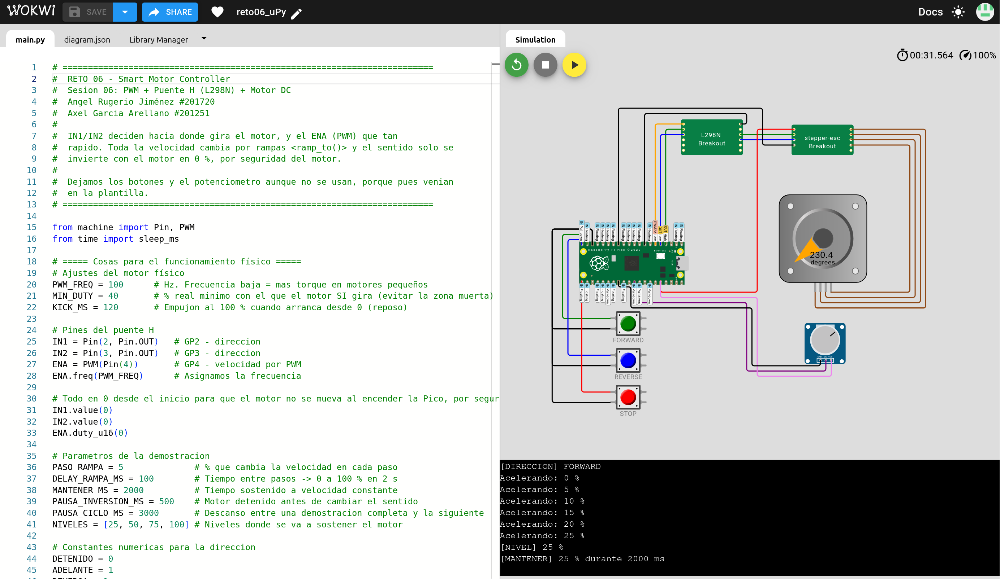

# lab-elem-programables

Portafolio del **Laboratorio de Elementos Programables** (Ibero Puebla, Otoño 2026). Cada sesión tiene un reto resuelto en **MicroPython** y, en las primeras, también en **C sobre el Pico SDK**. Todos se simulan en **Wokwi** y se prueban en una **Raspberry Pi Pico 2 W** (RP2350) física.

| Semáforo peatonal: Sesión 03 | Controlador de motor DC: Sesión 06 |
| --- | --- |
|  |  |

## Sesiones

| Sesión | Tema | Reto | Lenguaje | Simulación |
| --- | --- | --- | --- | --- |
| [02](Sesion_02_Conceptos_Basicos_MCU/) | Código → memoria → registros → GPIO | Medición de memoria y mapa de direcciones | MicroPython · C | [C](https://wokwi.com/projects/474015988609254401) · [uPy](https://wokwi.com/projects/474015080314429441) |
| [03](Sesion_03_GPIO_Pullup_Pulldown/) | GPIO, pull-up/pull-down y debounce | Semáforo peatonal interactivo | MicroPython · C | [uPy](https://wokwi.com/projects/474710654093435905) · [C](https://wokwi.com/projects/474711032994374657) |
| [04](Sesion_04_Interrupciones_Temporizadores/) | Interrupciones y temporizadores | Juego de reflejos | MicroPython · C | [uPy](https://wokwi.com/projects/474914467060140033) · [C](https://wokwi.com/projects/475442902587476993) |
| [06](Sesion_06_PWM_Motor_DC/) | PWM y puente H (L298N) | Smart Motor Controller | MicroPython | [Wokwi](https://wokwi.com/projects/476181809960581121) |
| [07](Sesion_07_ADC_Signal_Conditioning/) | ADC y acondicionamiento de señal | Smart Analog Monitor | MicroPython | [Wokwi](https://wokwi.com/projects/476812524253087745) |
| [08](Sesion_08_DualCore_Multitarea/) | Multitarea y dual-core | Sistema multitarea con `_thread` | MicroPython | [Wokwi](https://wokwi.com/projects/477448340995178497) |
| [09](Sesion_09_UART/) | Comunicación UART | UART Command Center (loopback GP0 → GP1) | MicroPython | Solo en placa física |

| Examen | Qué se construyó | Simulación |
| --- | --- | --- |
| [1er parcial](Examen_1er_Parcial/) | Escape room de hardware: máquina de estados con dos botones, antirrebote y bloqueo de seguridad | [Wokwi](https://wokwi.com/projects/475546415657558017) |
| [2do parcial](Examen_2do_Parcial/) | Sistema de control serial: parser de comandos en Core 0, adquisición ADC y botón en Core 1, LED por PWM | Solo en placa física |

## Mapa del repo

```
lab-elem-programables/
├── Sesion_01_Entorno/                     # prueba del entorno de desarrollo
├── Sesion_02_Conceptos_Basicos_MCU/
│   ├── micropython/memory_probe.py        # memoria libre con gc antes y después de reservar
│   ├── c_sdk/memory_map_demo.c            # direcciones de const, global, stack y heap
│   └── infographic/                       # infografía (PDF) del Challenge 02
├── Sesion_03_GPIO_Pullup_Pulldown/
│   ├── micropython/                       # 01 lectura del botón · 02 debounce · 03 semáforo
│   ├── cpp/                               # button_read.c y traffic_light.c (Pico SDK)
│   └── wokwi/                             # diagram.json del circuito y capturas
├── Sesion_04_Interrupciones_Temporizadores/
│   ├── micropython/                       # contador con IRQ, señal por timer, juego de reflejos
│   └── cpp/reaction_game.c                # el juego de reflejos en C
├── Sesion_06_PWM_Motor_DC/main.py         # rampas de velocidad e inversión segura del sentido
├── Sesion_07_ADC_Signal_Conditioning/main.py   # promedio móvil y estados NORMAL / WARNING / ALARM
├── Sesion_08_DualCore_Multitarea/
│   ├── main_wokwi.py                      # multitarea cooperativa con ticks_ms (1 núcleo)
│   └── main_dualcore_physical.py          # el sensor en Core 1 con _thread (Pico física)
├── Sesion_09_UART/
│   ├── main.py                            # parser de tramas SET / GET sobre el UART real
│   └── tabla_pruebas.csv                  # resultados de la tabla de pruebas
├── Examen_1er_Parcial/micropython/main.py
└── Examen_2do_Parcial/main.py
```

Cada sesión sigue el mismo patrón:

```
Sesion_XX_<Tema>/
├── README.md     # objetivo, circuito con pines, explicación del código y resultados
├── main.py       # o micropython/ y cpp/ cuando hay más de un programa
├── wokwi/        # diagram.json, enlace y capturas de la simulación
└── evidence/     # fotos y videos del montaje físico, salida del monitor serial
```

## Cómo correrlo

**En Wokwi**, sin hardware: abre el enlace de la sesión en la tabla de arriba y presiona ▶.

**MicroPython en la Pico 2 W:**

1. Flashea el firmware de MicroPython para Pico 2 W (arrastra el `.uf2` a la placa en modo BOOTSEL).
2. Abre la carpeta de la sesión en VS Code con la extensión **MicroPico** (o en Thonny).
3. Ejecuta `main.py` (o el script de la sesión) y mira la salida en el REPL.

**C con el Pico SDK** (Sesiones 02 a 04), con `PICO_SDK_PATH` configurado:

```bash
cd Sesion_03_GPIO_Pullup_Pulldown/cpp/traffic_light
mkdir build && cd build
cmake .. && make
# copia traffic_light.uf2 a la Pico en modo BOOTSEL
```

Los videos de evidencia están en **Git LFS**: corre `git lfs install` antes de clonar para bajarlos.

## Autoría

**Angel Rugerio Jiménez** (201720). La Sesión 06 y los dos exámenes son en equipo con **Axel García Arellano** (201251).

Licencia [MIT](LICENSE).
